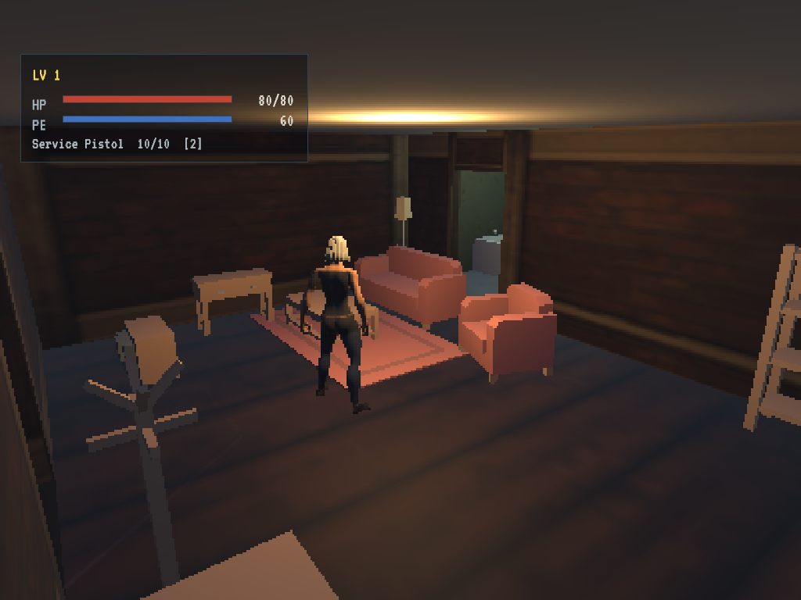
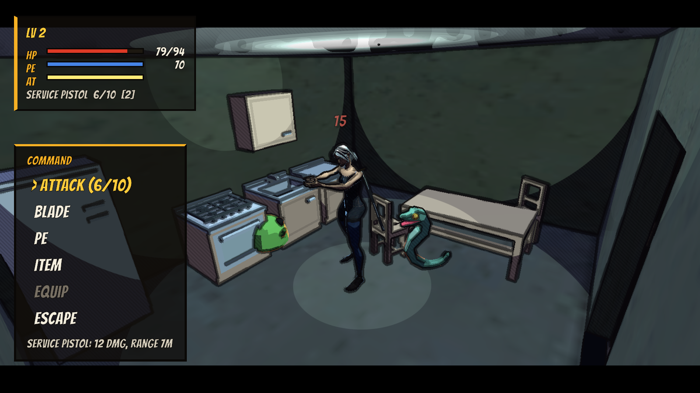
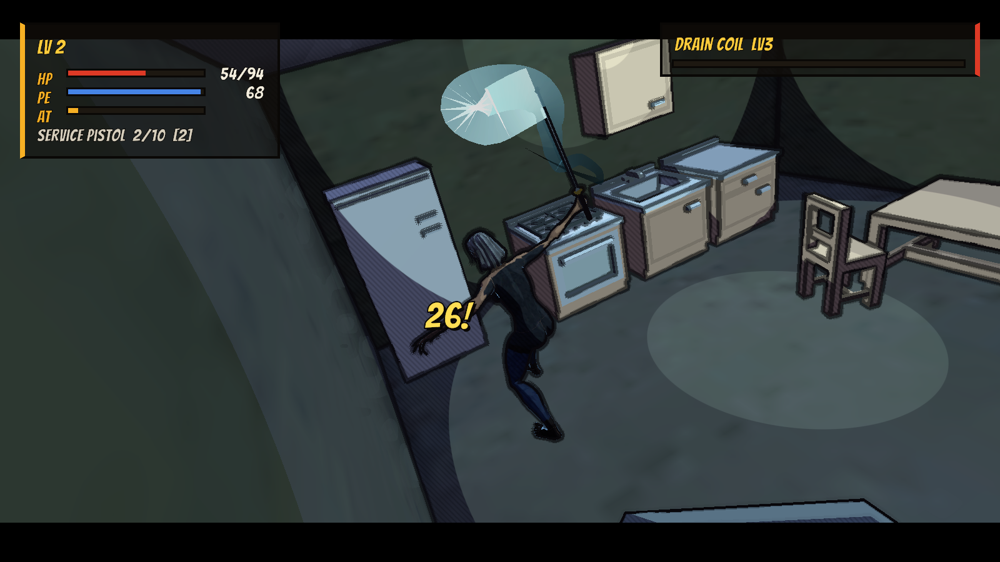
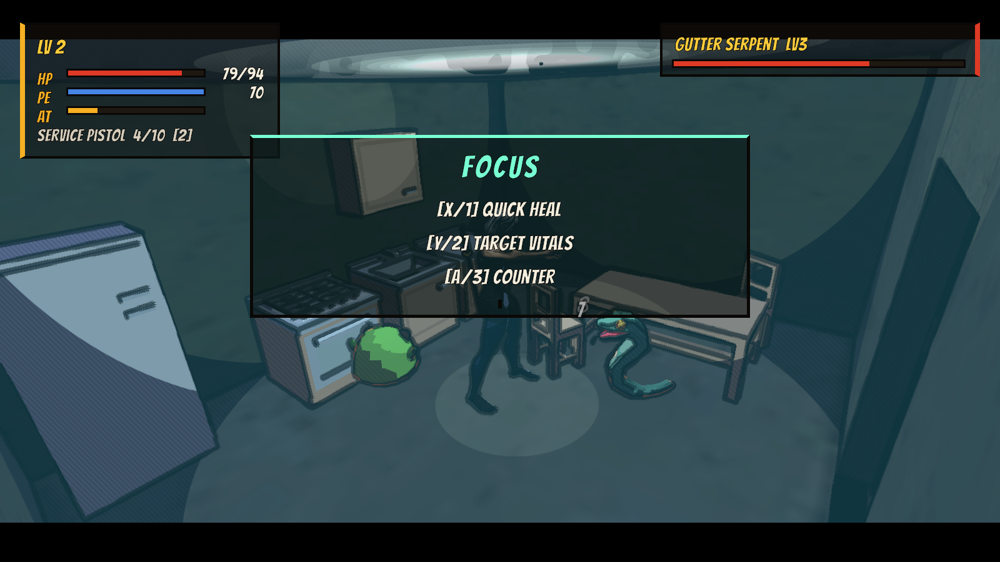
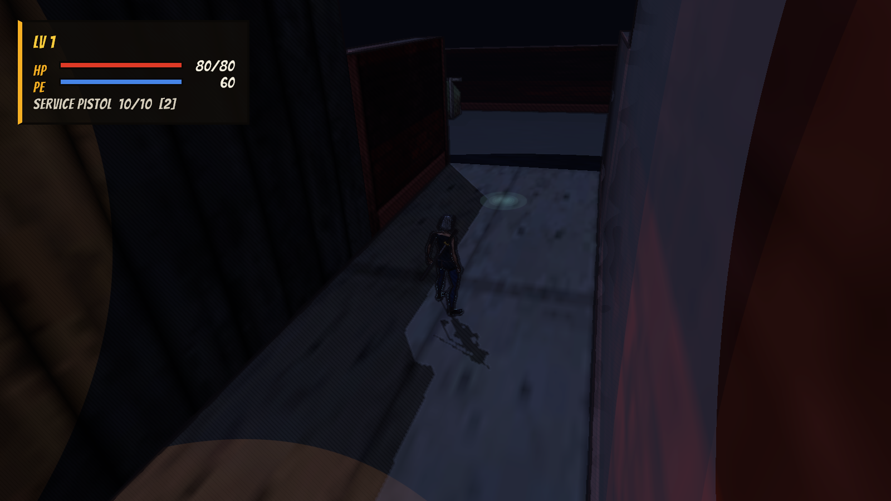

# Unity Eve

A proof of concept for a cel-shaded, hand-inked survival-horror RPG (Borderlands meets Parasite Mutant) with Parasite Eve's real-time/pause battle system, built in Unity 6 entirely from free (CC0/OFL) assets. You walk a street at night under fixed and CCTV cameras, enter houses, rummage through drawers and fridges, and fight creatures with an Active Time Bar, a hexagon range dome, a gun and a katana, PE abilities and grenades. On top of that sits one new idea, **Focus**: dodge an attack at the last moment and time slows, opening free bonus moves.

   



This is the Unity port of [ExperimentEve](https://github.com/mindattic/ExperimentEve) (the same game in Three.js and Babylon.js), whose battle numbers, enemy rhythm, camera rules and outfit painter it reuses.

## Why

- **Prove it can be made from free assets.** Every model, sound and font is CC0 or OFL and committed to the repo. Gunshots and stingers are synthesized by code. Nothing is bought or ripped.
- **Recapture the PE1 battle.** No open-source recreation of Parasite Eve's battle system existed, so this builds one: real time while the gauge fills, the world stops when you act, and the weapon's dome decides what you can hit.
- **Add one idea of its own.** Focus rewards precise dodging the way Max Payne and Clair Obscur: Expedition 33 do, but the game never requires it.
- **Built for PC with a controller.** It is gamepad-first with keyboard fallback, and the HUD is laid out for a monitor, not a phone.

## Features

### Parasite Eve battle
- **No screen transition.** Walking into an encounter zone makes the creatures materialize where you stand and seals the area with invisible walls.
- **Active Time Bar.** The gauge fills in real time while you move and dodge, using PE1's formula `(50 + ActiveTime) x gun multiplier` (pistol 1.0, shotgun 0.8, melee 2.0).
- **World pause.** With a full gauge, Confirm stops time and opens **Attack / PE / Item / Equip / Escape**.
- **Range dome.** Choosing Attack raises a faint wireframe shell of hexagons sized to the weapon's range. Only enemies inside it can be targeted. In rooms smaller than the range, the shell shows faintly through the walls.
- **Katana.** Kat carries a katana alongside her gun. The **Blade** command offers two arts:
  - *Slash:* a heavy cut that hits the target and anything beside it in a 110° arc, within 2.4 m.
  - *Rush (12 PE):* she dashes through a target up to 8 m away, cutting every creature along the line. She is untouchable mid-dash.
- **Weapon behaviour from PE1:**
  - *Rate of fire:* two rounds at 60% each.
  - *Burst:* the shotgun hits everything in range.
  - *Ammo* lives in a slot-limited bag, so bullets compete with medicine for space.
- **Parasite Energy.** Heal, Energy Shot, Haste, Slow and Barrier. PE regenerates during battle, but each cast slows the regeneration, as in PE1.
- **Items.**
  - *Grenade:* thrown on an arc, damages everything within 3 m.
  - *Flash grenade:* stuns everything within 3.5 m.
  - *Medicine, Cola and Mito Tonic:* restore HP or PE.
- **Readable enemy attacks** (from ExperimentEve). Each enemy cycles close → windup → strike → recover. During the windup it glows, and the pause freezes it mid-telegraph. At most two enemies commit to an attack at once.
- **Creatures that take turns.** The pack shares attack tokens, so one creature engages at a time (two in big packs), with a breather between turns. The engaged one stalks in or flanks toward Kat's back, rears up with a growl and a red glow, charges at a burst of speed, strikes, then retreats and hands the turn on. The rest keep to a ring around her: idling, pacing, glowing violet to enrage themselves (harder hits, faster tempo), or backing off if she gets close. Temperament shapes it: rats are eager, spiders and serpents flank, the Drain Coil hangs back and buffs.
- **Escape** succeeds more often against weaker packs. EXP, level-ups and Bonus Points feed Active Time, so the gauge fills faster as you grow.





### Focus (new)
- Dodge (B / Space) so that a strike lands within 0.3 s of starting the dodge. Time drops to 15% for 2.4 real seconds and three free moves appear, none of which spends ATB:
  - **Quick Heal:** a small heal.
  - **Target Vitals:** a guaranteed x3 weak-point shot at the attacker.
  - **Counter:** shoves and stuns the attacker.
- Missing the timing still evades through i-frames, and the window expires on its own. Players who never time a dodge lose nothing: the ATB menu alone wins every fight.



### Exploration
- **Fixed cameras** with camera zones that hard-cut like classic survival horror. Overlapping trigger volumes give hysteresis, so the camera doesn't flicker at boundaries.
- **CCTV cameras** stay mounted in place and servo-pan to follow you within yaw/pitch limits (the street, the alley, a kitchen nanny-cam). A **rail camera** slides along the street with you.
- **Direction latch.** While the stick is held, "up" keeps its meaning across camera cuts. The basis rotates to the new camera after a short grace period, so a cut never reverses you.
- **Doors** fade to black and move you between the street, the Mercer house and the shed. The shed is locked until you find its key.
- **Rummaging.** Hold Interact to search dumpsters, fridges, drawers, coat pockets, a medicine cabinet and tool chests. Each rolls a seeded loot table once.
- **Story beats.** Notes, posters and a TV broadcast tell it in one line each. Glinting pickups mark items in the open, and the shotgun waits in the shed.



### Presentation
- **Cel-shaded, inked render** (Borderlands / Parasite Mutant). Light falls in flat, anti-aliased bands and hard-edged pools, and tiled textures are flattened toward painted colour. A full-screen ink pass draws clean, even outlines at silhouettes and creases. Floors seen at a grazing angle never streak, and lines thin with distance and sink into the fog. The world renders at full window resolution with 4x MSAA, and the HUD uses comic panels and Bangers lettering. Hard cuts, fog and flickering bulbs complete the mood.
- **Kat** is a Quaternius Universal Base Character on the Universal Animation Library skeleton. Both share the same 65-joint rig, so the meshes are rebound by bone name with no retargeting. Her jeans, boots and tank top are painted into her albedo by a C# port of ExperimentEve's outfit painter.
- **Feel and sound.** Every event has a sound. Hits, crits, dodges and explosions add gamepad rumble and camera shake.

## Quick start

Prerequisites:
- Unity **6000.4.3f1** with Windows build support
- .NET SDK 10 (for the fast rules tests)

```powershell
git clone https://github.com/mindattic/UnityEve.git
cd UnityEve
```

Open the folder in Unity Hub, then open `Assets/UnityEve/Scenes/Demo.unity` and press Play. The scene and all generated content are committed, so there's nothing to build first.

Controls:

| Action | Gamepad | Keyboard |
| --- | --- | --- |
| Move | Left stick | WASD / arrows |
| Walk | Left stick click | Left Shift |
| Battle command (gauge full) / confirm | A | Enter / Z |
| Dodge / back | B | Space / X |
| Interact (hold to search) | X | E |
| Focus moves | X / Y / A | 1 / 2 / 3 |
| Menu (items, equip, controls) | Start | Esc / Tab |
| Menu navigation | D-pad / stick | Arrows / WASD |

## Commands

```powershell
./tools/test.ps1                 # pure-C# rules under dotnet test (seconds, no Unity)
./tools/test.ps1 -Compile        # + batch-mode Unity compile check

# Regenerate every generated asset and the Demo scene from code
./tools/unity.ps1 -Method UnityEve.Editor.DemoContentBuilder.BuildAll -Log content

# Build the Windows player (Build/Windows/UnityEve.exe)
./tools/unity.ps1 -Method UnityEve.Editor.UnityEveBuild.BuildWindows -Log build -Graphics

# Self-play: tour, rummage, fight all three encounters, screenshot every beat, then quit.
# Batch mode renders offscreen, so no window opens. Exit code 0 = PASS.
Build/Windows/UnityEve.exe -batchmode -autoplay -artifacts artifacts/autoplay -logFile artifacts/autoplay.log
```

Unity batch mode needs the Editor closed on this project; `tools/unity.ps1` refuses to run if it's open.

## How it's built

```text
Assets/UnityEve/
  Core/        UnityEve.Core (noEngineReferences)   ATB, PE, damage, Focus, enemy attack cycle,
                                                   inventory, loot, camera-zone selection, movement basis
  Runtime/     UnityEve.Runtime                     MonoBehaviours: BattleDirector, EnemyActor, PlayerController,
                                                   CameraDirector/Shot/Zone, interactables, GameHud (UI Toolkit),
                                                   WorldTime, GameInput (Input System), Autopilot
  Editor/      UnityEve.Editor                      DemoContentBuilder (data, prefabs, animators, scene),
                                                   WavSynth, OutfitPainter, build entry points
  Art/         CC0 models, sounds, OFL font (see CREDITS.md)
  Generated/   output of DemoContentBuilder: ScriptableObjects, materials, clips, prefabs, audio
  Scenes/      Demo.unity (generated)
Tests/         Core.Tests: xUnit against Assets/UnityEve/Core compiled as netstandard2.1
tools/         unity.ps1 (batch mode), test.ps1 (the gate)
docs/          BIBLE.md (design canon), USER_STORIES.md (status + evidence)
```

| Layer | Rule |
| --- | --- |
| Core | Pure C#, no UnityEngine, seeded `Rng` only. Every rule is unit-tested in seconds. |
| Runtime | Thin MonoBehaviours over Core. Presentation never decides a rule. One owner of `Time.timeScale` (`WorldTime`). |
| Content | Weapons, items, PE abilities, enemies, loot and sounds are ScriptableObjects, editable in the Inspector. `DemoContentBuilder` regenerates them, the prefabs and the scene deterministically. |
| Verification | `dotnet test` for rules; `-autoplay` drives the real game through every system and writes screenshots. |

## Limitations

- This is a proof of concept with Ashgrove Street, the Market district, two interiors, six fixed encounters plus random re-entry encounters, and eleven creature types (seven mutated animals, four aliens). There is no save system, title flow beyond a title card, or music.
- Enemies move by transform with simple separation, not a navmesh. Arena walls keep fights contained.
- Bonus Points are spent automatically on Active Time rather than through a menu.
- The shotgun pickup uses the survival kit's axe mesh as a stand-in.

## Documentation

- [docs/BIBLE.md](docs/BIBLE.md): what this is and isn't, its laws, architecture, glossary
- [docs/USER_STORIES.md](docs/USER_STORIES.md): every feature with status and the test or autoplay step that proves it
- [CREDITS.md](CREDITS.md): asset sources and licenses
- [AGENTS.md](AGENTS.md): instructions for AI agents working in this repo

## License

This repo has no LICENSE file, so all rights are reserved for the code. Third-party assets keep their own licenses (CC0 and OFL); see [CREDITS.md](CREDITS.md).

Part of [MindAttic](https://mindattic.com). See more projects at [github.com/mindattic](https://github.com/mindattic). Related: [ExperimentEve](https://github.com/mindattic/ExperimentEve).
